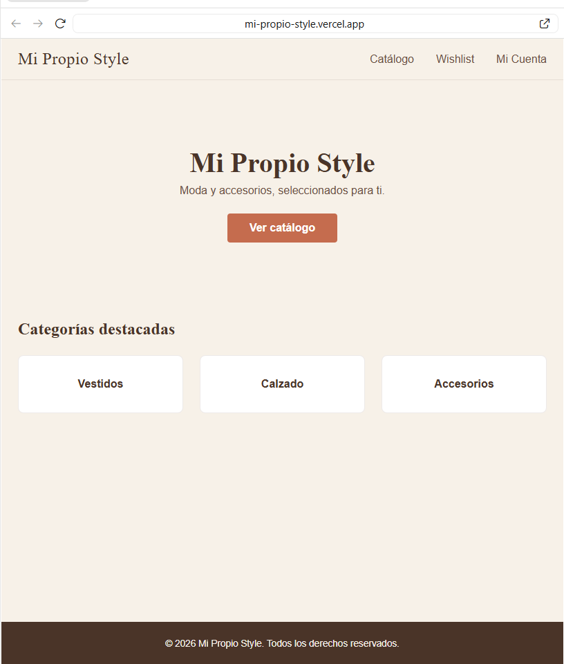
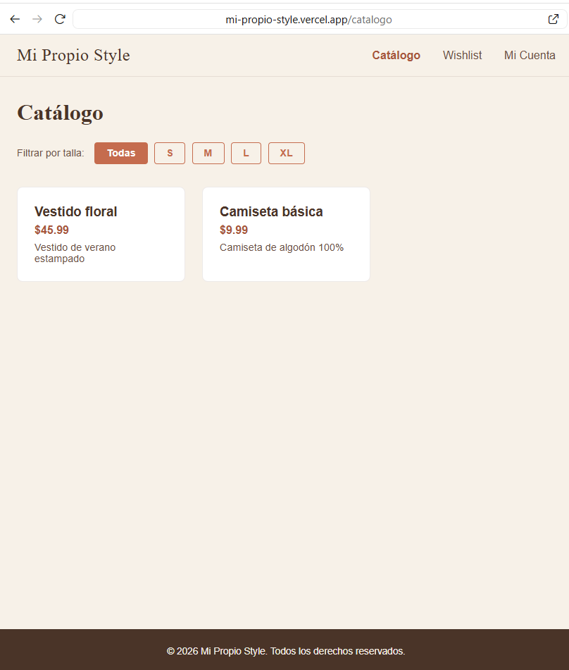

# Mi Propio Style

E-market multivendedor de moda y accesorios construido con arquitectura de microservicios. Proyecto final (capstone) del Full Stack Developer Bootcamp de Maestro University.

**Demo en vivo:** https://mi-propio-style.vercel.app/
**API Auth:** https://mi-propio-style-auth.onrender.com/docs · **API Catálogo:** https://mi-propio-style-catalogo.onrender.com/docs · **API Órdenes:** https://mi-propio-style-ordenes.onrender.com/docs

> Los servicios están en un plan gratuito de hosting: la primera petición tras un rato de inactividad puede tardar unos segundos mientras "despierta" el servicio.




## Qué hace

- **Cuentas de usuario** con registro, login y rutas protegidas (JWT).
- **Catálogo** de productos con filtros (categoría, talla, rango de precio, búsqueda por nombre) y paginación.
- **Tallas con stock** por producto; las tallas agotadas se muestran deshabilitadas.
- **Wishlist** por usuario, sin duplicados.
- **Reseñas** con calificación de 1 a 5 (una por usuario y producto; crear, editar y eliminar).
- **Compra completa**: crear orden, pago simulado, descuento real de stock e historial en "Mis Órdenes".
- **Notificación por email** cuando baja el precio de un producto en tu wishlist.

## Arquitectura

Tres microservicios independientes y un frontend:

| Servicio | Responsabilidad |
|---|---|
| `services/auth` | Registro, login, emisión y validación de JWT |
| `services/catalogo` | Productos, tallas, wishlist, reseñas y job de notificaciones |
| `services/ordenes` | Órdenes, pago simulado y descuento de stock |
| `frontend` | SPA en React |

- Auth emite los tokens; catálogo y órdenes solo los validan.
- Órdenes habla con catálogo mediante una `SERVICE_KEY` interna (header `X-Service-Key`), separada de la autenticación de usuarios, para descontar stock en nombre del comprador.
- Todas las llamadas entre servicios tienen `timeout` y manejo de errores.

## Tecnologías

**Frontend:** React 19, Vite, react-router-dom, SCSS Modules
**Backend:** Python, FastAPI, SQLAlchemy, Pydantic
**Base de datos:** PostgreSQL (Supabase)
**Autenticación:** JWT (python-jose) + bcrypt
**Extra aprendido fuera del curso:** APScheduler (jobs periódicos) y Resend (email transaccional)
**Hosting:** Vercel (frontend) · Render (APIs) · Supabase (PostgreSQL)

## Cómo ejecutarlo en local

Requisitos: Node 20+, Python 3.11+, una base de datos PostgreSQL.

```bash
# Cada servicio (auth, catalogo, ordenes) en su propia terminal
cd services/auth        # luego catalogo y ordenes
python -m venv venv && source venv/bin/activate   # en Windows: venv\Scripts\activate
pip install -r requirements.txt
cp .env.example .env    # completa las variables (ver abajo)
uvicorn app.main:app --reload --port 8002   # auth 8002, catalogo 8001, ordenes 8000

# Frontend
cd frontend
npm install
cp .env.example .env
npm run dev
```

Cada servicio incluye un `.env.example` documentado con todas sus variables:

| Servicio | Variables principales |
|---|---|
| `services/auth` | `DATABASE_URL`, `SECRET_KEY`, `ACCESS_TOKEN_EXPIRE_MINUTES` |
| `services/catalogo` | `DATABASE_URL`, `SECRET_KEY`, `SERVICE_KEY`, `ORDENES_SERVICE_URL`, `RESEND_API_KEY` |
| `services/ordenes` | `DATABASE_URL`, `SECRET_KEY`, `SERVICE_KEY`, `CATALOGO_URL` |

`SECRET_KEY` debe ser la misma en los tres servicios (auth firma los JWT; catálogo y órdenes los validan) y `SERVICE_KEY` la misma en catálogo y órdenes. No subas nunca un `.env` real al repositorio.

La documentación interactiva de cada API está en `/docs` (Swagger).

## Tests y CI

Auth y órdenes tienen tests con pytest que usan una base SQLite temporal, así que no necesitan PostgreSQL ni claves reales:

```bash
cd services/auth        # o services/ordenes
pip install -r requirements.txt -r ../requirements-dev.txt
python -m pytest
```

En cada push y pull request, GitHub Actions (`.github/workflows/ci.yml`) ejecuta esos tests y también el lint y el build del frontend.

## Decisiones de diseño y problemas resueltos

- **Pago simulado y reemplazable:** la lógica del cobro está aislada en `pagos.py`; sustituirla por Stripe o PayPal no tocaría el resto del flujo.
- **Registro sin `role`:** el endpoint público no permite auto-asignarse rol de admin o vendedor.
- **HTTPBearer en catálogo:** catálogo solo valida tokens, así que usa `HTTPBearer` y no `OAuth2PasswordBearer` (esto rompía Swagger por CORS).
- **Bug del `.env` con BOM:** Vite no leía la primera variable; diagnosticado con `Format-Hex`.
- **`precio_anterior` calculado por el backend:** al bajar un producto de precio se guarda automáticamente y se reinicia el aviso en las wishlists.

Detalle completo de cada decisión en [`NOTES.md`](NOTES.md).

## Limitaciones conocidas

- Si el descuento de stock falla a mitad de una orden con varios productos, el stock queda parcialmente descontado. Solucionarlo de raíz requiere transacciones distribuidas (patrón saga), fuera del alcance del proyecto.
- Latencia en el primer acceso por el plan gratuito de hosting.
- El filtro de talla distingue mayúsculas de minúsculas.

## Próximos pasos

- Integrar un gateway de pago real.
- Panel de vendedor para gestionar productos y órdenes.
- Ampliar los tests: hoy cubren auth y órdenes; faltan catálogo y el frontend.
- Mantener los servicios activos para eliminar los retrasos de arranque.

## Licencia

Distribuido bajo la licencia [MIT](LICENSE).

## Autora

Miguelina Rosario ([Open Consultech](https://www.openconsultech.net))